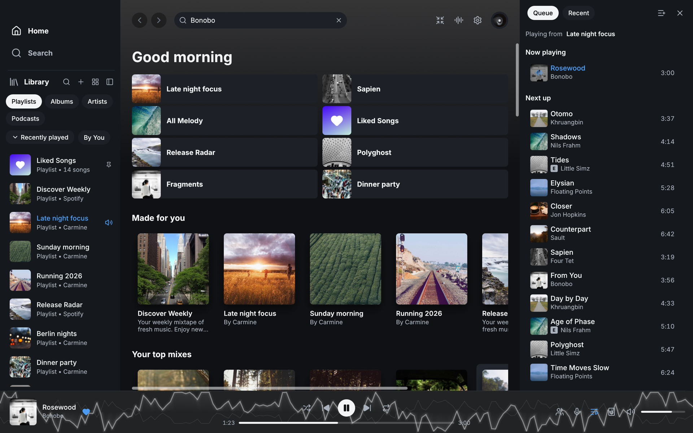

<p align="center">
  
</p>

<h1 align="center">Spotifast Free</h1>

<p align="center"><strong>Spotify, native and fast, for Free and Premium accounts.</strong><br>A lightweight music app built on top of <a href="https://github.com/crmne/spotifast">Spotifast</a>.</p>

<p align="center">
  <a href="#install"><strong>Install</strong></a> ·
  <a href="#spotify-free">Spotify Free</a> ·
  <a href="https://github.com/skanderkaroui/spotifast-free/issues">Issues</a>
</p>

<p align="center">
  <a href="Cargo.toml"></a>
  <a href="#spotify-free"></a>
  <a href="LICENSE"></a>
</p>

Spotifast Free is a fork of [Spotifast](https://github.com/crmne/spotifast)
by Carmine Paolino that adds playback for **Spotify Free** accounts.
Everything else comes from Spotifast: a Spotify client written in Rust with
[egui](https://www.egui.rs) and [fastframe](https://fastframe.dev) that
typically uses 100–250 MB of RAM and starts in well under a second.

- **Premium** plays through [librespot](https://github.com/librespot-org/librespot),
  exactly as in Spotifast, or through Spotify's optional
  [Soloist](https://spotifast.rocks/soloist/) player.
- **Free** plays through Spotify's own web player, which Spotifast Free runs
  unchanged in a small background helper and controls from its native
  interface. On macOS for now.

The interface includes complete
[translations for all supported languages](docs/_reference/translating.md#languages-and-coverage).



## Spotify Free

On a Free account, Spotifast Free starts a helper that loads
open.spotify.com in macOS's built-in WebKit and sends it the same Spotify
Connect requests the web player sends for its own buttons. Spotify plays
every song and every ad itself, with its own DRM and restrictions.

| What | On a Free account |
|---|---|
| **Plays** | A playlist, album, song, list of songs or Liked Songs; next, previous, seek, shuffle, repeat, volume (it follows the slider as you drag), add to queue, and Spotify's radio |
| **Shows** | Play counts on artist and album pages, artist followers and monthly listeners, Spotify's own lyrics (LRCLIB as fallback), playlist folders, EPs labelled as EPs, who added each song to a shared playlist, and audiobooks apart from podcasts |
| **Edits** | Create, rename and describe playlists, add, move and remove songs, change a cover, save albums, shows and episodes, follow playlists |
| **Ads** | Played by Spotify and shown as the playing item; skip and seek are held while one plays, as on Spotify |
| **Hidden** | Other devices and Cast, queue editing and Play next, local files, Soloist, the equalizer, visualizers and MilkDrop, playback engine settings, upcoming releases and pre-save. Spotify plays the audio inside WebKit, so Spotifast Free cannot hear or route it |
| **Linux** | Free plays through a separate helper download (castLabs Electron, about 120 MB): unpack `spotifast-…-linux-free-helper-x86_64.tar.gz` (or `aarch64`) from the release into `~/.local/share`, so it sits at `~/.local/share/spotifast-free-helper`. Spotifast Free finds it, and its sign-in offers Spotify Free |
| **Not yet** | Free playback on Windows. That build plays Premium only, like Spotifast |

The helper keeps its own Spotify sign-in, separate from your browsers. It
starts with Spotifast Free and keeps running, so the first press plays at
once. How it works, its limits, and how it is
checked against Spotify's web player: [scope](experiments/SCOPE-free-playback.md)
and [helper](experiments/macos-playback-host/README.md).

## Install

Download Spotifast Free from the
[latest release](https://github.com/skanderkaroui/spotifast-free/releases/latest):
a Mac `.dmg`, Windows `.msi`, and Linux `.tar.gz` and AppImage. The Mac app
is not notarized yet; the first time, right-click it in Applications and
choose **Open**. The Homebrew, AUR and download-page builds are upstream
Spotifast, which plays Premium only.

Or build Spotifast Free.app from source on macOS 14 or later with Rust and the
Xcode command-line tools:

```sh
git clone https://github.com/skanderkaroui/spotifast-free.git
cd spotifast-free
cargo build --release --no-default-features --bin spotifast
sh experiments/macos-playback-host/build.sh
bash packaging/macos/bundle.sh target/release/spotifast "Spotifast Free.app" "$(sed -n 's/^version = "\(.*\)"/\1/p' Cargo.toml | head -1)"
open "Spotifast Free.app"
```

`bundle.sh` puts the playback helper inside the app, both with the
Spotifast Free icon. Move the app to `/Applications` to keep it.
`--no-default-features` leaves out MilkDrop, which needs cmake, a C++
compiler and libclang; drop it to build MilkDrop for Premium.
Spotifast's [build from source](https://spotifast.rocks/getting-started/#build-from-source)
guide lists every dependency.

Spotifast Free keeps its own settings, Keychain sign-in and log
(`~/Library/Application Support/io.github.skanderkaroui.SpotifastFree`), so
it runs alongside upstream Spotifast without sharing anything.

## Start listening

1. **Premium:** register Spotifast with Spotify, as the sign-in screen
   shows: in the [Spotify developer dashboard](https://developer.spotify.com/dashboard),
   create an app with the redirect URI `http://127.0.0.1:8989/login` and
   **Web API** ticked, paste its Client ID into Spotifast Free and choose
   **Sign in with Spotify**. Spotify closed the shared app Spotifast used to
   new sign-ins, and only Premium accounts can make an app of their own.
2. **Premium:** open the device menu in the player bar and choose **Set up
   playback here**, then approve playback in your browser. Your computer
   appears as a Spotify Connect device named **Spotifast** (rename it in
   Settings).
3. **Free:** press play. The first time, Spotify's own sign-in opens in a
   small window; sign in there and it closes by itself, and the song you
   picked starts. You stay signed in after that.

Spotifast Free remembers your sign-in in the macOS Keychain. A local build
is signed again on every rebuild, so macOS asks once more after each one;
choose **Always Allow**.

Since 0.15, setup leads with Spotify's
[Soloist player](https://spotifast.rocks/soloist/), with guided key setup,
one-time pairing and automatic renewal of expiring builds. New listeners and
people updating see this choice once after sign-in on supported platforms.
**Use the built-in player** keeps librespot, with Spotifast's EQ, visualizers,
local files and full queue editing. The choice is remembered.
On Linux with PipeWire, Soloist also supports Spotifast’s EQ and visualizers
through a private audio route. [Native audio support](https://spotifast.rocks/soloist/#native-audio)
adds EQ and visualizers on macOS 14.2 or newer, and visualizers on Windows 11,
including MilkDrop. Windows Soloist playback does not support audible EQ.
The Mac route keeps Soloist at full volume after redirecting its output,
then applies Spotifast’s volume after the visualizers, including mute. Phone
volume changes adjust that output level; Spotify’s indicator returns to 100%.
Windows visuals follow Soloist’s source volume and stop when it is muted.
When enabled, Soloist appears as **This computer**; settings show the controls
that apply to it. Turning it off restores the built-in player's preferences.
While Soloist starts and its account is verified, the Spotify loading screen shows
**Verifying Soloist…** and waits to accept playback commands. Setup takes three
steps, and ends with choosing the named device in Spotify, with the built-in
player available as a quiet alternative below the card. If Soloist stops later,
a banner over the app says so while Spotifast restarts it, and offers **Try
again** if that does not work. **Settings → Spotify Soloist → Spotify access**
connects the separate Spotify session for Made for you, listening activity and
Spotify lyrics without changing players.

## Your music, on your desktop

| Feature | What you can do |
|---|---|
| **Library and search** | Browse playlists, Liked Songs, albums, artists, and podcasts. Discover upcoming albums on artist pages and open their countdown to pre-save. Search the catalogue and edit playlists you own. Copy a song's link, title, or artists from its menu. |
| **Local files** | Premium: play the local files your playlists list from a folder you choose in Settings, at any sample rate. Names show spaces and accents correctly, including in cached playlists. |
| **Lyrics** | Spotify lyrics when the playback session is signed in, with LRCLIB as fallback. Temporary LRCLIB overloads retry and try search; older cached lyrics remain available during outages. |
| **Spotify Connect** | Premium: play on this computer or control your other devices, including Google Cast speakers and groups. Cast devices appear as they are discovered; frequently and recently chosen outputs rise to the top. Remote volume keeps your chosen level while Spotify updates. |
| **Queue** | Add songs to the queue. On Premium, **Play next** puts a song or selection first when playing on this computer. |
| **Themes** | Choose light, dark, system appearance, or custom colours, with one theme for light mode and one for dark mode that switch with the system. On Omarchy, follow your desktop theme. |
| **Desktop controls** | Use keyboard shortcuts, media keys and the command line (`spotifast play`, `next`, `now-playing`…; the command is still called `spotifast`). Start Spotifast Free with your computer, with its window or in the tray. |
| **Winamp mini player** | Use classic skins with an equalizer, playlist, and animated sound displays, also in the collapsed title bar. Premium only for the equalizer and visuals. |
| **MilkDrop** | Watch music-reactive visuals, Premium only. See Spotifast's [MilkDrop guide](https://spotifast.rocks/milkdrop/). |

Spotifast's [user guide](https://spotifast.rocks/using-spotifast/) covers
these in detail; everything in it applies to Spotifast Free except the
install steps, the file locations above and the Premium requirement. Its
[troubleshooting page](https://spotifast.rocks/troubleshooting/) explains
"Spotify refused the audio key" and "Spotify is being slow".

## Tests

```sh
cargo fmt --check
cargo clippy --no-default-features --all-targets -- -D warnings
cargo test --no-default-features

# The helper's page script, offline, against recorded Spotify responses
node experiments/macos-playback-host/test.mjs
node experiments/macos-playback-host/diagnostics.test.mjs

# Live, against a running Spotifast Free signed in with a Free account (the
# debug build from experiments/run-free.sh, or
# SPOTIFAST=".../Spotifast Free.app/Contents/MacOS/Spotifast Free")
bash experiments/free-e2e.sh
```

The Free/Premium test matrix is in `src/app/free_matrix_tests.rs`. Recorded
Spotify responses go through
`experiments/macos-playback-host/scrub-recordings.mjs` before they are
committed, so no account's songs or playlists end up in the repository.

## Contributing

Report Free playback problems in
[Spotifast Free's issues](https://github.com/skanderkaroui/spotifast-free/issues),
with the steps and the log. Anything that also happens in upstream Spotifast
belongs [upstream](https://github.com/crmne/spotifast/issues). See
[CONTRIBUTING.md](CONTRIBUTING.md) before opening a pull request.

To look at the interface without a Spotify account, run:

```sh
cargo run --features demo -- --demo
```

Upstream Spotifast does not embed a browser engine, so Free playback lives
in this fork. Spotifast Free follows upstream and rebases on its releases.

## Acknowledgements

Built on [Spotifast](https://github.com/crmne/spotifast) by Carmine Paolino,
which uses [librespot](https://github.com/librespot-org/librespot),
[egui](https://www.egui.rs), [fastframe](https://fastframe.dev), the [Inter](https://rsms.me/inter/)
typeface (OFL), and [Lucide](https://lucide.dev) icons (ISC).

Spotifast Free is independent and is not affiliated with Spotify or with
upstream Spotifast. Spotify is a trademark of Spotify AB.

Licensed under the [MIT License](LICENSE).
