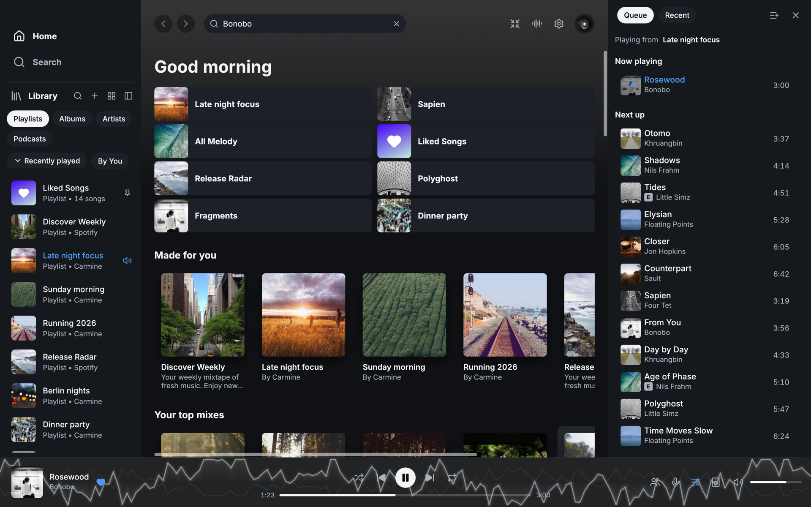

<p align="center">
  
</p>

<h1 align="center">Spotifast Free</h1>

<p align="center"><strong>Spotify, native and fast, for Free and Premium accounts.</strong><br>A lightweight music app built on top of <a href="https://github.com/crmne/spotifast">Spotifast</a>.</p>

<p align="center">
  <a href="#install"><strong>Install</strong></a> ·
  <a href="#spotify-free">Spotify Free</a> ·
  <a href="#ads-stay">Ads</a> ·
  <a href="https://github.com/skanderkaroui/spotifast-free/issues">Issues</a>
</p>

<p align="center">
  <a href="Cargo.toml"></a>
  <a href="#spotify-free"></a>
  <a href="LICENSE"></a>
</p>

Spotifast Free is a fork of [Spotifast](https://github.com/crmne/spotifast)
by Carmine Paolino that adds playback for **Spotify Free** accounts.
Everything else comes from Spotifast: a Spotify client written in Rust with
[egui](https://www.egui.rs) and [fastframe](https://fastframe.dev) that
typically uses 100–250 MB of RAM and starts in well under a second.

- **Premium** plays through [librespot](https://github.com/librespot-org/librespot),
  exactly as in Spotifast.
- **Free** plays through Spotify's own web player, which Spotifast Free runs
  unchanged in a small background helper and controls from its native
  interface. On macOS for now.

**Spotifast Free does not remove, skip or mute ads.** Free accounts hear
Spotify's ads, as on any Spotify app. See [Ads stay](#ads-stay).

The interface includes complete
[translations for all supported languages](docs/_reference/translating.md#languages-and-coverage).



## Spotify Free

On a Free account, Spotifast Free starts a helper that loads
open.spotify.com in macOS's built-in WebKit and sends it the same Spotify
Connect requests the web player sends for its own buttons. Spotify plays
every song and every ad itself, with its own DRM and restrictions.

| On Free | |
|---|---|
| **Works** | Play a playlist, album, song, list of songs or Liked Songs; next, previous, seek, shuffle, repeat, volume, add to queue, and Spotify's radio |
| **Ads** | Played by Spotify and shown as the playing item; skip and seek are held while one plays, as on Spotify |
| **Hidden** | Other devices and Cast, queue editing, the equalizer, visualizers and MilkDrop, playback engine settings, pre-save. Spotify plays the audio inside WebKit, so Spotifast Free cannot hear or route it |
| **Not yet** | Free playback on Windows and Linux. Those builds play Premium only, like Spotifast |

The helper keeps its own Spotify sign-in, separate from your browsers, and
quits after five idle minutes. How it works, its limits, and how it is
checked against Spotify's web player: [scope](experiments/SCOPE-free-playback.md)
and [helper](experiments/macos-playback-host/README.md).

## Ads stay

Spotifast Free is a faster window onto Spotify Free, not a way around it.

- Ads play in full, at their own volume. Nothing blocks, skips, mutes,
  shortens or hides them.
- Spotify's own restrictions apply: while an ad plays, skip and seek are
  held, exactly as in Spotify's apps.
- Spotifast Free never reads, records or replaces Spotify's audio, never
  touches its DRM or keys, and never pretends a Free account is Premium.

This is a rule of the project. Changes that skip, block, mute or hide ads,
or work around Spotify's Free restrictions, will not be accepted (see
[CONTRIBUTING.md](CONTRIBUTING.md)). If you want no ads, Spotify Premium
removes them and plays through librespot in this same app.

## Install

There are no prebuilt downloads of Spotifast Free yet. The Homebrew, AUR
and download-page builds are upstream Spotifast, which plays Premium only.
Build Spotifast Free.app from source on macOS 14 or later with Rust and the
Xcode command-line tools:

```sh
git clone https://github.com/skanderkaroui/spotifast-free.git
cd spotifast-free
cargo build --release --no-default-features --bin spotifast
sh experiments/macos-playback-host/build.sh
bash packaging/macos/bundle.sh target/release/spotifast "Spotifast Free.app" "$(sed -n 's/^version = "\(.*\)"/\1/p' Cargo.toml | head -1)"
open "Spotifast Free.app"
```

`bundle.sh` puts the playback helper inside the app, both with the
Spotifast Free icon. Move the app to `/Applications` to keep it.
`--no-default-features` leaves out MilkDrop, which needs cmake, a C++
compiler and libclang; drop it to build MilkDrop for Premium.
Spotifast's [build from source](https://spotifast.rocks/getting-started/#build-from-source)
guide lists every dependency.

Spotifast Free keeps its own settings, Keychain sign-in and log
(`~/Library/Application Support/io.github.skanderkaroui.SpotifastFree`), so
it runs alongside upstream Spotifast without sharing anything.

## Start listening

1. Open Spotifast Free and choose **Sign in with Spotify**. Approve access
   in your browser, then return to the app.
2. **Premium:** open the device menu in the player bar and choose **Set up
   playback here**, then approve playback in your browser. Your computer
   appears as a Spotify Connect device named **Spotifast** (rename it in
   Settings).
3. **Free:** press play. The first time, Spotify's own sign-in opens in a
   small window; sign in there and it closes by itself, and the song you
   picked starts. You stay signed in after that.

Spotifast Free remembers your sign-in in the macOS Keychain. A local build
is signed again on every rebuild, so macOS asks once more after each one;
choose **Always Allow**.

## Your music, on your desktop

| Feature | What you can do |
|---|---|
| **Library and search** | Browse playlists, Liked Songs, albums, artists, and podcasts. Search the catalogue and edit playlists you own. |
| **Spotify Connect** | Premium: play on this computer or control your other devices, including Google Cast speakers and groups. |
| **Themes** | Choose light, dark, system appearance, or custom colours. On Omarchy, follow your desktop theme. |
| **Desktop controls** | Use keyboard shortcuts, media keys and the command line (`spotifast play`, `next`, `now-playing`…; the command is still called `spotifast`). |
| **Winamp mini player** | Use classic skins with an equalizer, playlist, and animated sound displays. Premium only for the equalizer and visuals. |
| **MilkDrop** | Watch music-reactive visuals, Premium only. See Spotifast's [MilkDrop guide](https://spotifast.rocks/milkdrop/). |

Spotifast's [user guide](https://spotifast.rocks/using-spotifast/) covers
these in detail; everything in it applies to Spotifast Free except the
install steps, the file locations above and the Premium requirement.

## Tests

```sh
cargo fmt --check
cargo clippy --no-default-features --all-targets -- -D warnings
cargo test --no-default-features

# The helper's page script, offline, against recorded Spotify responses
node experiments/macos-playback-host/test.mjs
node experiments/macos-playback-host/diagnostics.test.mjs

# Live, against a running Spotifast Free signed in with a Free account (the
# debug build from experiments/run-free.sh, or
# SPOTIFAST=".../Spotifast Free.app/Contents/MacOS/Spotifast Free")
bash experiments/free-e2e.sh
```

The Free/Premium test matrix is in `src/app/free_matrix_tests.rs`. Recorded
Spotify responses go through
`experiments/macos-playback-host/scrub-recordings.mjs` before they are
committed, so no account's songs or playlists end up in the repository.

## Contributing

Report Free playback problems in
[Spotifast Free's issues](https://github.com/skanderkaroui/spotifast-free/issues),
with the steps and the log. Anything that also happens in upstream Spotifast
belongs [upstream](https://github.com/crmne/spotifast/issues).

Changes that skip, block, mute or hide ads, or work around Spotify's Free
restrictions, are out of scope and will be closed. See
[CONTRIBUTING.md](CONTRIBUTING.md).

To look at the interface without a Spotify account, run:

```sh
cargo run --features demo -- --demo
```

Upstream Spotifast does not embed a browser engine, so Free playback lives
in this fork. Spotifast Free follows upstream and rebases on its releases.

## Acknowledgements

Built on [Spotifast](https://github.com/crmne/spotifast) by Carmine Paolino,
which uses [librespot](https://github.com/librespot-org/librespot),
[egui](https://www.egui.rs), [fastframe](https://fastframe.dev), the [Inter](https://rsms.me/inter/)
typeface (OFL), and [Lucide](https://lucide.dev) icons (ISC).

Spotifast Free is independent and is not affiliated with Spotify or with
upstream Spotifast. Spotify is a trademark of Spotify AB.

Licensed under the [MIT License](LICENSE).
